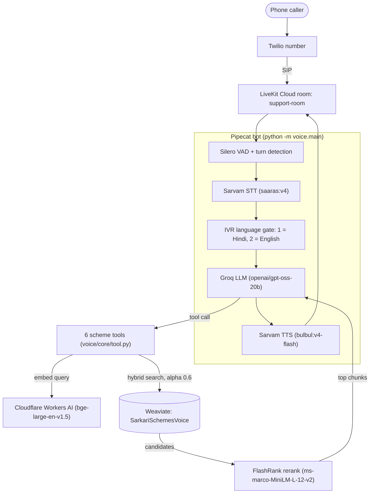

<div align="center">

# Sarkari Sahayak

**Government welfare schemes, one phone call away.**

A voice assistant that helps people in India find the government welfare schemes they qualify
for. Callers dial a phone number and speak naturally. It works on any phone, needs no internet,
and the caller never has to read anything.

[](LICENSE)


<sub>Built for the Agent&#123;a&#125;thon hackathon · Open Innovation Track · by Team **The Debuggers**</sub>

</div>

---

## Table of Contents

- [Overview](#overview)
- [The Problem](#the-problem)
- [Key Features](#key-features)
- [Architecture](#architecture)
- [How a Call Works](#how-a-call-works)
- [Retrieval and Tools](#retrieval-and-tools)
- [Data and Schema](#data-and-schema)
- [Tech Stack](#tech-stack)
- [Getting Started](#getting-started)
- [Configuration](#configuration)
- [Evals](#evals)
- [Web Chat (in progress)](#web-chat-in-progress)
- [Project Structure](#project-structure)
- [Deployment](#deployment)
- [Limitations and Roadmap](#limitations-and-roadmap)
- [Team](#team)
- [License](#license)
- [Acknowledgements](#acknowledgements)

---

## Overview

India runs thousands of welfare schemes, but the people who need them most often can't find or
claim them. The information sits on text-heavy, mostly English government portals that assume
strong reading and digital skills.

**Sarkari Sahayak** takes the portal out of the picture. A caller rings an ordinary phone number,
picks Hindi or English on the keypad, and talks. The assistant asks a few questions about their
situation, finds matching schemes, and explains one thing at a time: what the scheme gives, who
qualifies, which documents are needed, and how to apply.

Every answer comes from a knowledge base of **3,356 Central and State government schemes** from
[myScheme](https://www.myscheme.gov.in/), split into **16,795 section-level chunks**. The model
is instructed never to describe a scheme, amount, or rule that a retrieval tool didn't return.

> **Status:** the phone line in `voice/` is the working product. The `frontend/` and `chatbot/`
> folders hold a web chat channel from an earlier version; the UI runs, but its backend doesn't
> currently start. See [Web Chat](#web-chat-in-progress).

**Demo:** a demo phone line (Twilio trial number) is available on request.

---

## The Problem

- Welfare information is scattered, mostly in English, and buried in complex web portals.
- Eligibility rules (age, income, occupation, category) are left for the citizen to decode alone.
- Central and State schemes overlap and are easy to confuse.
- Many intended beneficiaries pay middlemen to find their benefits, or give up.

---

## Key Features

- **Works on any phone.** A plain voice call through Twilio and LiveKit; no smartphone, app, or
  data connection needed.
- **Keypad language menu.** Press 1 for Hindi or 2 for English. The choice locks speech
  recognition, the voice, and the reply language for the rest of the call.
- **Grounded answers.** Six retrieval tools sit between the model and the data. The system prompt
  forbids answering about any specific scheme from the model's own memory.
- **Section-aware follow-ups.** After a scheme is found, follow-up questions pull just that
  scheme's eligibility, documents, benefits, application steps, or overview, using its `scheme_id`.
- **Hybrid retrieval.** Dense embeddings plus BM25 keyword search in Weaviate, reranked with
  FlashRank and deduplicated so the caller hears distinct schemes.
- **Written for the ear.** Short spoken sentences, no lists or markdown, and one piece of
  information per turn so the caller can steer.
- **Measured retrieval.** A golden query set scores precision, recall, MRR, NDCG, and latency
  (see [Evals](#evals)).

---

## Architecture



The pipeline is assembled in `voice/core/pipeline.py` in this order: LiveKit input → Silero VAD →
Sarvam STT → IVR gate → context aggregator → Groq LLM → Sarvam TTS → LiveKit output. Tool calls
run on a worker thread so a slow search never blocks the audio loop.

---

## How a Call Works

1. **The call arrives.** Twilio hands the call to LiveKit over SIP, and LiveKit places the caller
   in the `support-room` room, where the bot is already waiting as `scheme-setu-bot`.
2. **Language menu.** The IVR gate (`voice/core/ivr.py`) plays the menu, each line in its own
   language. Speech is ignored until a key is pressed. Key 1 locks Hindi, key 2 locks English.
   With no valid key after 6 seconds the menu plays once more, and after a second timeout the call
   locks to Hindi. Locking adds a reply-language instruction to the LLM context and retunes STT
   and TTS (language and voice). All menu settings live in `voice/core/languages.py`.
3. **Turn-taking.** Silero VAD (0.5 s of silence) starts and ends speech segments, and Pipecat's
   default turn-stop strategy decides when the caller has finished. Sarvam `saaras:v4` transcribes.
4. **Thinking.** Groq's `openai/gpt-oss-20b` runs with low reasoning effort and a 512-token cap to
   keep replies fast. The prompt (`voice/core/prompt.py`) tells it to ask about the caller's state,
   age, and occupation before searching, to translate every tool query into English, and to work
   the state or Central/State preference into the query text.
5. **Looking it up.** The model calls one of six tools (next section) and answers only from what
   comes back.
6. **Speaking.** Sarvam `bulbul:v4-flash` speaks the reply at 1.4x pace. Each v4 voice speaks one
   language, so Hindi calls use `aditya_hi_conversational` and English calls use
   `dev_en_conversational`.

---

## Retrieval and Tools

The LLM sees six tools, defined in `voice/core/tool.py` and backed by `voice/retrieval/retriever.py`.

| Tool | Used when | What it retrieves |
| --- | --- | --- |
| `search_schemes(query)` | The caller describes a need or names a scheme | Hybrid search over all chunks, 15 candidates, all reranked, deduplicated by `scheme_id`, top 3 schemes returned with their `scheme_id` |
| `check_scheme_details(query, scheme_id)` | "Tell me about this scheme" | That scheme's `details` section |
| `check_benefits(query, scheme_id)` | "What will I get?" | That scheme's `benefits` section |
| `check_eligibility(query, scheme_id)` | "Do I qualify?" | That scheme's `eligibility` section |
| `check_documents(query, scheme_id)` | "What papers do I need?" | That scheme's `documents` section |
| `check_application_process(query, scheme_id)` | "How do I apply?" | That scheme's `application` section |

Each `check_*` tool filters Weaviate to one `scheme_id` and one `section`, takes 5 candidates,
reranks them, and returns the best one. All searches are hybrid: a dense vector from Cloudflare's
`bge-large-en-v1.5` combined with BM25 over `sparse_text`, at `alpha=0.6`.

The retriever functions also accept a `government_level` filter (`Central` / `State`). The voice
tools don't expose it; the model puts that preference in the query text instead. The retrieval
eval does use the filter.

---

## Data and Schema


| Step | File | What happens |
| --- | --- | --- |
| Raw export | `data/updated_data.csv` | 3,400 schemes from myScheme: name, slug, details, benefits, eligibility, application, documents, level, category, tags |
| Clean and chunk | `data/compact_data_cleaning_chunked_sections.ipynb` | Drops incomplete rows, cleans text for the LLM and TTS, and splits each scheme into five section rows |
| Ingest-ready CSV | `data/schemes_compact_cleaned_merged_chunked.csv` | 16,795 rows (3,356 schemes × 5 sections); 2,650 Central and 14,145 State rows |
| Load | `voice/retrieval/loader.py` | CSV → LangChain Documents |
| Embed and store | `voice/retrieval/ingest.py` | Embeds and upserts in batches of 200, retries on HTTP 429, resumes from a checkpoint |

Each row becomes one Weaviate object in the `SarkariSchemesVoice` collection:

| Field | Role |
| --- | --- |
| `document_text` | Scheme name plus section prose. This is what the LLM reads. |
| `sparse_text` | Normalized keywords. This is what BM25 matches on. |
| `scheme_id`, `scheme_name` | Identity, repeated on all five rows of a scheme |
| `section` | `details` / `benefits` / `eligibility` / `documents` / `application`, used by the `check_*` filters |
| `government_level` | `Central` / `State` |

---

## Tech Stack

| Layer | Technology |
| --- | --- |
| Telephony | Twilio (phone number) → LiveKit Cloud (SIP bridge, real-time audio room) |
| Voice orchestration | Pipecat, Silero VAD, Pipecat turn detection |
| Speech | Sarvam AI: `saaras:v4` (STT), `bulbul:v4-flash` (TTS) |
| LLM | Groq: `openai/gpt-oss-20b`, low reasoning effort |
| Embeddings | Cloudflare Workers AI: `@cf/baai/bge-large-en-v1.5` |
| Vector store | Weaviate (self-hosted in Docker), hybrid dense + BM25 |
| Reranker | FlashRank: `ms-marco-MiniLM-L-12-v2` |
| Data pipeline | pandas, LangChain (`CSVLoader`, `langchain-weaviate`, `langchain-cloudflare`) |
| Data source | myScheme (Government of India) |

---

## Getting Started

### Prerequisites

- Python 3.11+ and Docker
- Accounts and API keys for **Groq**, **Sarvam AI**, **Cloudflare** (Workers AI), and **LiveKit
  Cloud**. **Twilio** is needed only to take real phone calls.

### 1. Clone

```bash
git clone https://github.com/Parth-KG/Sarkari-Sahayak.git
cd Sarkari-Sahayak
```

Run every command below from the repository root. The code imports itself as the `voice` package.

### 2. Install

```bash
python -m venv .venv
source .venv/bin/activate          # Windows: .venv\Scripts\activate
```

```bash
pip install -r voice/requirements.txt
```

`voice/requirements.txt` is a lock file that works on Windows, macOS, and Linux. Don't edit it by
hand: add or bump packages in `voice/requirements.in`, then regenerate the lock with
[uv](https://docs.astral.sh/uv/):

```bash
uv pip compile voice/requirements.in --universal --python-version 3.11 -o voice/requirements.txt
```

### 3. Environment variables

```bash
cp voice/.env.example voice/.env
```

Fill in the keys listed under [Configuration](#configuration).

### 4. Start Weaviate

```bash
docker run -d --name weaviate \
  -p 8080:8080 -p 50051:50051 \
  -v weaviate_data:/var/lib/weaviate \
  -e PERSISTENCE_DATA_PATH=/var/lib/weaviate \
  -e CLUSTER_HOSTNAME=node1 \
  -e AUTHENTICATION_ANONYMOUS_ACCESS_ENABLED=true \
  cr.weaviate.io/semitechnologies/weaviate:1.40.0
```

No vectorizer module is needed; embeddings are computed by Cloudflare before they reach Weaviate.
The named volume keeps the data between restarts, so you only ingest once.

### 5. Ingest the scheme data

The ingest reads `data/schemes_compact_cleaned_merged_chunked.csv` and keeps its checkpoint in
`data/ingest_progress.txt`. To use a different folder, such as a mounted volume in a container,
set `DATA_DIR`.

```bash
python -m voice.retrieval.ingest --reset-progress
```

Use `--reset-progress` the first time. The committed `data/ingest_progress.txt` already reads
`16795` from the team's own run, so without the flag the script assumes everything is ingested and
does nothing. If a run stops partway, for example on Cloudflare rate limits, rerun it without the
flag and it resumes from the last finished batch.

### 6. Run the voice agent

```bash
python -m voice.main
```

Weaviate must already be running, because the retriever connects when it's imported. The bot joins
`support-room` and waits for a caller.

### 7. Talk to it without a phone

```bash
python -m voice.generate_token
```

This prints a join token for `support-room`. Open [LiveKit Meet](https://meet.livekit.io), choose
the **Custom** tab, and paste your `LIVEKIT_URL` and the token. A browser can't send keypad tones,
so the language menu times out twice and the call locks to Hindi after about 12 seconds.

`python -m voice.voice_server` is an alternative entry point: a FastAPI app on port 8000 with
`GET /token`, `GET /health`, and a `/ws` WebSocket that starts a bot for as long as the socket
stays open. Run either `voice.main` or `voice.voice_server`, not both, or two bots will join the
same room.

### 8. Connect a phone number

Phone routing is set up in Twilio and LiveKit, not in this repo. Point a Twilio number at a LiveKit
SIP inbound trunk, then add a dispatch rule that sends callers to the `support-room` room. LiveKit's
[Twilio guide](https://docs.livekit.io/telephony/accepting-calls/inbound-twilio) and
[dispatch rule docs](https://docs.livekit.io/telephony/accepting-calls/dispatch-rule) cover both steps.

---

## Configuration

Set these in `voice/.env`:

| Variable | Required | Used for |
| --- | --- | --- |
| `LIVEKIT_URL` | Yes | LiveKit project URL (`wss://<project>.livekit.cloud`) |
| `LIVEKIT_API_KEY` | Yes | LiveKit authentication |
| `LIVEKIT_API_SECRET` | Yes | LiveKit authentication |
| `GROQ_API_KEY` | Yes | Conversation LLM |
| `SARVAM_API_KEY` | Yes | Speech-to-text and text-to-speech |
| `CLOUDFLARE_ACCOUNT_ID` | Yes | Embeddings, used during ingest and on every search |
| `CLOUDFLARE_API_TOKEN` | Yes | Embeddings |
| `WEAVIATE_HOST` | No | Weaviate host; defaults to `localhost` (ports 8080 and 50051) |
| `DATA_DIR` | No | Folder with the scheme CSV and ingest checkpoint; defaults to the repo's `data/` |

`voice/core/config.py` refuses to start if the LiveKit or Groq values are missing.

---

## Evals

Retrieval is scored against a 10-query golden set (`voice/eval/retrieval-evals/golden_eval_set.jsonl`)
that covers scholarships, pensions, fisheries, farming, and more, with both exact and paraphrased
wording. Results from the committed run (`eval_results.json`, k = 3, alpha 0.6, 15 candidates):

| Precision@3 | Recall@3 | MRR | NDCG@3 |
| --- | --- | --- | --- |
| 0.60 | 0.92 | 0.95 | 0.90 |

The right scheme is almost always ranked first (MRR 0.95), and nearly every expected scheme shows
up in the top three. Precision looks low because eight of the ten queries have only one or two
correct schemes, so with k = 3 the best possible average is 0.67.

| Latency per search (median) | Time |
| --- | --- |
| Embed + hybrid search | 0.73 s |
| Rerank | 1.11 s |
| Total | 1.84 s |

Reranking is the largest fixed cost. One query hit a one-off 5.8 s embedding spike, which pulls
the mean total up to 2.35 s.

To rerun, make sure Weaviate is running with data ingested, then run from the repository root.
The script reads the golden set and writes `eval_results.json` next to itself:

```bash
PYTHONPATH=. python voice/eval/retrieval-evals/evaluate_retrieval.py
```

---

## Web Chat (in progress)

The repo also holds a text chat channel from an earlier version of the project:

- **`frontend/`** is a React 19 + Vite + Tailwind CSS chat UI with an animated background,
  markdown replies, and example prompts such as "PM-Kisan eligibility". It runs with
  `npm install && npm run dev` and sends `POST /chat` with `{ message, history }` to `VITE_API_URL`
  (default `http://localhost:8000`). See [`frontend/README.md`](frontend/README.md).
- **`chatbot/`** holds the matching chat backends. They were built on Qdrant, and both fail at
  import today: `chat_server.py` needs `chatbot/data/query.py`, and `server.py` needs `src.core`
  and `data.scheme_tool`, none of which are in the repo.

The UI loads but can't answer until a `/chat` backend is rebuilt on top of `voice/retrieval/`.
`voice/voice_server.py` doesn't serve `/chat`.

---

## Project Structure

```
Sarkari-Sahayak/
├── voice/                                  # The phone agent
│   ├── main.py                             # Entry point: joins support-room and runs the pipeline
│   ├── voice_server.py                     # FastAPI alternative: /token, /ws, /health
│   ├── generate_token.py                   # Prints a LiveKit join token for local testing
│   ├── requirements.in                     # Direct dependencies (edit this)
│   ├── requirements.txt                    # Lock file generated from requirements.in
│   ├── .env.example                        # Template for API keys
│   ├── core/
│   │   ├── pipeline.py                     # Assembles the Pipecat pipeline
│   │   ├── transport.py                    # LiveKit transport and bot token
│   │   ├── ivr.py                          # Keypad language gate
│   │   ├── languages.py                    # Language menu: digits, voices, prompts
│   │   ├── prompt.py                       # System prompt
│   │   ├── tool.py                         # The 6 tool schemas and their handlers
│   │   └── config.py                       # Loads and checks environment variables
│   ├── services/
│   │   ├── stt.py                          # Sarvam saaras:v4
│   │   ├── tts.py                          # Sarvam bulbul:v4-flash
│   │   └── llm.py                          # Groq gpt-oss-20b
│   ├── retrieval/
│   │   ├── loader.py                       # CSV -> LangChain Documents
│   │   ├── embeddings.py                   # Cloudflare Workers AI embeddings
│   │   ├── vectorstore.py                  # Weaviate connection
│   │   ├── reranker.py                     # FlashRank
│   │   ├── retriever.py                    # search_schemes and the 5 section lookups
│   │   └── ingest.py                       # Batched, resumable embed + upsert
│   ├── eval/retrieval-evals/               # Golden set, eval script, latest results
│   ├── to-be-fixed*.pdf                    # Engineering backlog
│   └── sarkari-sahayak-voice-architecture.html   # Walkthrough page
├── data/
│   ├── updated_data.csv                    # Raw myScheme export
│   ├── compact_data_cleaning_chunked_sections.ipynb   # Cleaning and chunking notebook
│   ├── schemes_compact_cleaned_merged_chunked.csv     # 16,795 section chunks, ready to ingest
│   └── ingest_progress.txt                 # Ingest resume checkpoint
├── frontend/                               # Web chat UI (see Web Chat)
├── chatbot/                                # Earlier chat backends (not currently runnable)
├── docs/                                   # Architecture (.dot source) and schema diagrams
└── LICENSE
```

---

## Deployment

- **Voice agent:** a long-running worker that connects out to LiveKit, so it needs an always-on
  host. The first run downloads the FlashRank and Silero models.
- **Weaviate:** run it on the same host, or set `WEAVIATE_HOST` and expose ports 8080 and 50051.
  The named Docker volume keeps the data, so restarts don't require a new ingest.
- **Embeddings:** every search makes a Cloudflare Workers AI call. The free tier's per-minute and
  daily limits were reached during testing, so real traffic needs a paid plan.

---

## Limitations and Roadmap

Most of these come from the team's backlog in `voice/to-be-fixed*.pdf`.

**Current limitations**

- **One shared room.** Every caller joins `support-room`. Two people calling at once would end up
  in the same conversation, so this must change before the line handles more than one caller.
- **Language testing.** Keypad selection has only been exercised through the browser timeout path,
  not with real phone tones. Only Hindi has been tested end to end, and `saaras:v4` and the
  `bulbul:v4-flash` voices haven't been tried on a live call yet.
- **Open token endpoint.** `GET /token` in `voice_server.py` has no auth and always issues the same
  identity.
- **Latency.** Each tool call spends about 1.8 s on retrieval, about 1.1 s of it in reranking.
- **No memory across calls**, and the scheme data is a one-time snapshot with no refresh job.
- **No monitoring** beyond terminal logs.
- **Web chat backend** doesn't run (see [Web Chat](#web-chat-in-progress)).

**Roadmap**

- A separate LiveKit room per call, through SIP dispatch rules or generated room names.
- Real phone testing of the keypad menu, then more languages. Adding one only means a new entry in
  `voice/core/languages.py`.
- Faster reranking with a smaller cross-encoder (such as `ms-marco-TinyBERT-L-2-v2`) or fewer
  candidates.
- Caching for common queries.
- Auth on the token endpoint, plus error alerting and monitoring.
- Rebuild the chat backend on the Weaviate retrieval stack and relaunch the web channel.
- Scheduled refresh of the scheme data.

---

## Team

**The Debuggers**, built for the Agent&#123;a&#125;thon hackathon (Open Innovation Track).

- Jagrit Goel (Team Lead)
- Parth Krishan Goswami
- Milind Suman
- Soahum Trivedi

---

## License

Released under the [MIT License](LICENSE).

---

## Acknowledgements

- Scheme data from [myScheme](https://www.myscheme.gov.in/) (Government of India).
- Built with [Pipecat](https://www.pipecat.ai/), [LiveKit](https://livekit.io/),
  [Sarvam AI](https://www.sarvam.ai/), [Groq](https://groq.com/), [Weaviate](https://weaviate.io/),
  [FlashRank](https://github.com/PrithivirajDamodaran/FlashRank), and
  [Cloudflare Workers AI](https://developers.cloudflare.com/workers-ai/).
